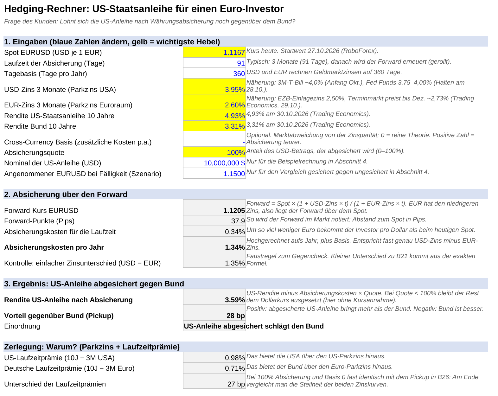
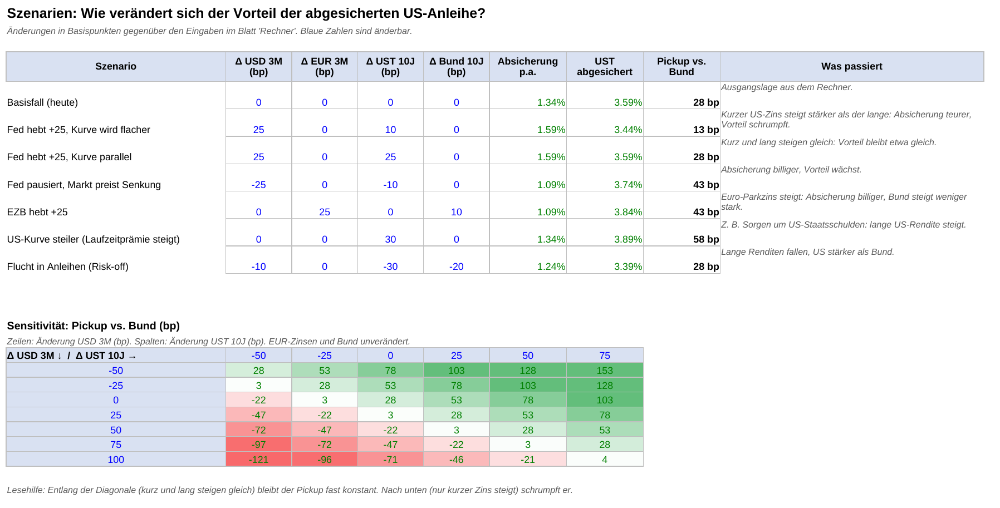
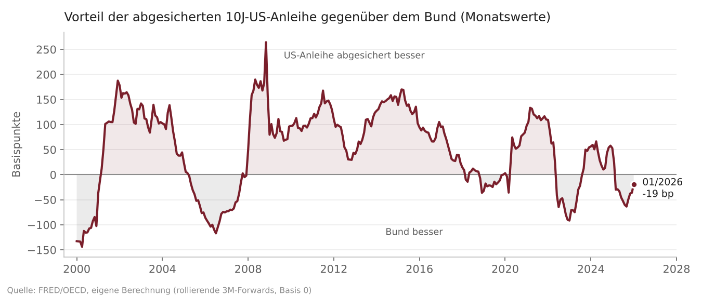

# Hedging-Kosten-Monitor

Excel/VBA-Tool zu einer typischen Frage institutioneller Euro-Investoren:
**Lohnt sich eine US-Staatsanleihe nach Währungsabsicherung noch gegenüber dem Bund?**

## Ergebnis (Stand 30.10.2026)

| | |
|---|---|
| Absicherungskosten p.a. (rollierende 3M-Forwards) | 1,34 % |
| Rendite US-Staatsanleihe 10J nach Absicherung | 3,59 % |
| Rendite Bund 10J | 3,31 % |
| **Vorteil der abgesicherten US-Anleihe** | **+28 bp** |

Bei voller Absicherung tauscht der Investor den kurzen US-Zins gegen den kurzen Euro-Zins. Übrig bleibt im Kern der Unterschied der Laufzeitprämien (USA 98 bp, Deutschland 71 bp). Der Vorteil hängt also weniger vom Dollarkurs ab als von der Steilheit der beiden Zinskurven.

**Größtes Risiko:** Die Fed hebt am kurzen Ende an, ohne dass die langen Renditen mitziehen. Schon +25 bp am kurzen Ende allein würden den Vorteil fast vollständig aufzehren.

## Szenarien und Sensitivität

## Historie seit 2000

Der Vorteil schwankte zwischen rund −140 und +260 bp. Im Januar 2026 war der Bund noch die bessere Wahl.

## Dateien

- `Hedging_Monitor.xlsx`: Rechner, Szenarien und Historie
- `Hedging_Monitor_Modul.bas`: VBA-Makro, das vier Zinsreihen von FRED (OECD) lädt und das Blatt „Historie“ mit Daten und Formeln füllt (Windows-Excel)
- `Kurzanalyse_Hedging_Monitor.pdf`: Zusammenfassung auf einer Seite

## Grenzen

- Der Forward folgt der gedeckten Zinsparität. Die Cross-Currency Basis ist optional und steht standardmäßig auf 0. Eine realistische Basis würde den Vorteil verringern.
- Betrachtet wird nur der laufende Ertrag (Carry), keine Kursgewinne oder -verluste.
- Die Historie nutzt OECD-Monatsdurchschnitte mit 1–2 Monaten Verzögerung. Die Startwerte im Rechner sind Näherungen und sollten vor Verwendung mit Marktdaten geprüft werden.
